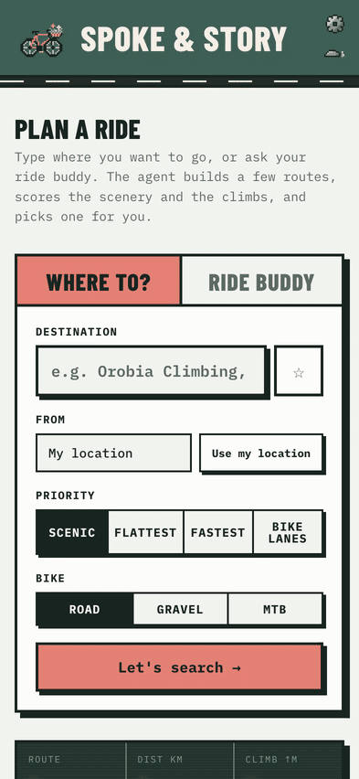
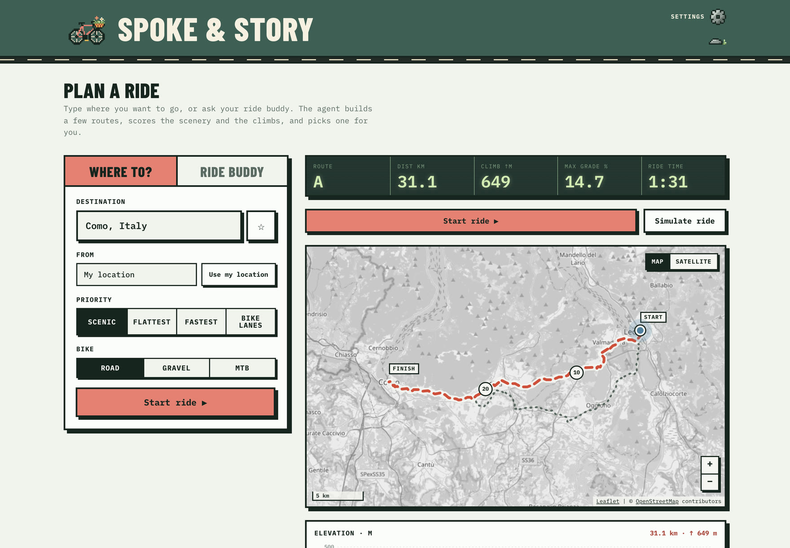
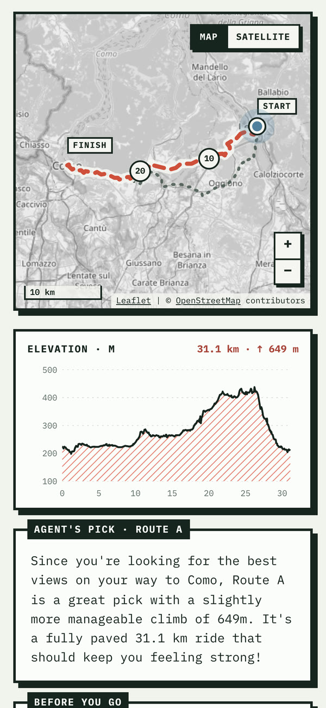
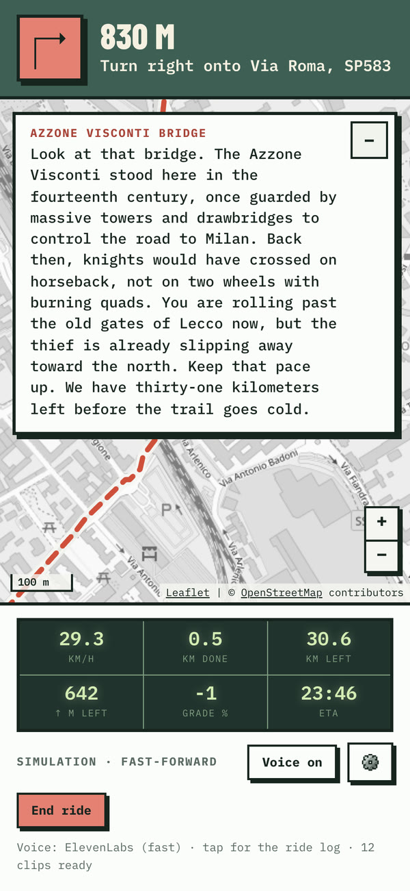
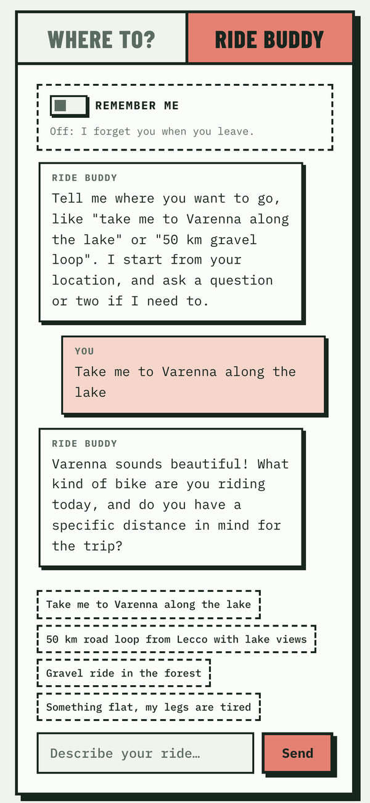

# Spoke & Story

A bike route planner with a funny ride guide. Tell it where you want to go, it finds a nice route, and on the way
Santa tells you one silly, connected story about the places you pass.

Built for the DEV Hacktoberfest 2026 "Touch Grass" challenge: open-source AI that gets you outside.

**Try it:** https://spoke-and-story.tech (best on a phone: ride mode uses your GPS)

<p align="center">
  
</p>

## What you can do

- **Where to?** Type a destination (typos are fine), pick Scenic, Flattest or Fastest and your bike. You get up to
  3 routes in a few seconds, then Gemma picks one and tells you why.
- **Ride buddy:** prefer to chat? Say what you feel like ("50 km gravel loop", "something flat, my legs are dead").
  It asks at most two questions, then plans the ride.
- **Saved places and Home:** tap ☆ next to the destination to save it, and set Home in ⚙️ Settings (from a saved
  place or where you are). They show as one-tap chips under the boxes: your daily "Home → climbing gym" is two taps.
- **Pin on the map:** press and hold the map (right-click on a computer) for "Ride here", "Start here" or "⭐ Save".
- **Remember me** (Ride buddy tab, off by default): the buddy keeps what you tell it ("hates climbs") and a short log of
  your rides, on your phone. Ride the same route again and Santa continues the story as the next episode, with new
  places and the last ride's cliffhanger.
- **Ride mode:** "Start ride" follows your GPS ("Simulate" fast-forwards, handy at home). You get the real turns only,
  bike-computer stats and an off-route warning. Santa tells a story built from Wikipedia facts about the places along
  the route, in his own voice: ElevenLabs by default (about a second a line), or Kokoro, an open-source voice that
  runs on your phone (one switch in ⚙️ Settings).
- **Live guide:** each chapter is written as you near its place (a circle around it, on route or off), comments on
  your speed, a new route when you go off course, fun stops (cafés, gelato, pubs) and stories about the area when it's
  quiet.

**On-device voice:** if you pick Kokoro (or ElevenLabs isn't available), your browser downloads the voice model
once: about 92 MB (`Kokoro-82M-v1.0-ONNX`, q8) plus about 22 MB for the ONNX runtime, so roughly 115 MB. Use Wi-Fi
for that one. After that it's cached.

## Screenshots



<table>
  <tr>
    <td></td>
    <td></td>
    <td></td>
  </tr>
  <tr>
    <td align="center">Routes and Gemma's pick</td>
    <td align="center">A chapter of the story, mid-ride</td>
    <td align="center">Ride buddy</td>
  </tr>
</table>

## How it works

| Part | Uses | File |
|---|---|---|
| Place search, start/end lookup | **Photon** (open source, OpenStreetMap, no key), limited to 200 km around the start | `app/photon.py` |
| Routing (A to B, loops) | **OpenRouteService** directions | `app/ors.py` |
| Route stats | climb, steepest 200 m, paved and quiet-road share | `app/route_stats.py` |
| Scenery score | **Overpass** (OpenStreetMap): water, forest, viewpoints. Skipped if it takes over 8 s | `app/scenery.py` |
| Ranking | Scenic / Flattest / Fastest, loops within 25% of the asked distance | `app/planner.py` |
| LLM (pick, chat, story) | **Gemma 4 26B-A4B** through Backboard (~2 s). Google AI Studio is the fallback | `app/agent.py` |
| Story places | **Wikipedia** places near the route, with their summaries | `app/story.py` |
| Voice | **ElevenLabs** Flash v2.5 on the server (~1 s a line). **Kokoro-82M** in your browser as the open-source option and fallback | `app/tts.py`, `web/js/voice.js` |
| Map | **Leaflet** with OpenStreetMap tiles, Esri satellite view | `web/js/map.js` |
| Ride, turns, narration | | `web/js/ride.js` |

The backend is a small FastAPI app. The page is plain HTML and JavaScript, no build step.

### Voice

Gemma, the open model, writes the guide; ElevenLabs gives it a voice. `POST /api/tts` turns one line into an mp3
(Flash v2.5, voice "George", a warm storyteller). A line takes about a second, so only the intro is made when the
ride starts; every other line is made as it comes up (the next few km), and a ride pays only for what is said. Kokoro,
the open-source voice that runs in your browser, takes over when the server has no key, the day's budget is spent,
ElevenLabs keeps failing, or you pick it in Settings. Kokoro voices a line sentence by sentence, so Santa starts
talking after the first sentence instead of waiting for the whole line.
A line missed without signal (a tunnel) is skipped, apart from turns, which are asked for again.

The key stays on the server. Costs are capped there: 800 characters a line, `ELEVENLABS_DAILY_CHARS` a day for
everyone together (default 10,000) and 6,000 an hour per visitor. The server keeps the last 200 lines in memory, so
the same line is paid once. `GET /api/voice` tells the page whether ElevenLabs is available.

## Run locally

You need Python 3.12 and a free [OpenRouteService key](https://openrouteservice.org/dev/#/signup).

```bash
git clone https://github.com/Danialmoa/spoke-and-story.git && cd spoke-and-story
python3.12 -m venv .venv && source .venv/bin/activate
pip install -r requirements.txt
cp .env.example .env      # add your keys
uvicorn app.main:app --reload
```

Open http://localhost:8000. The API docs are at http://localhost:8000/docs.

Tests and lint: `pip install pytest ruff && python -m pytest -q && ruff check .`

### Environment variables

| Variable | Needed? | What for |
|---|---|---|
| `ORS_API_KEY` | yes | Routing |
| `BACKBOARD_API_KEY` | recommended | Gemma 4 in ~2 s through [Backboard](https://app.backboard.io). Empty = Google only |
| `BACKBOARD_MODEL` | no | Default `google/gemma-4-26b-a4b-it` |
| `GEMINI_API_KEY` | yes | [Google AI Studio](https://aistudio.google.com/apikey): the fallback (or only) Gemma host, ~20-40 s |
| `LLM_MODEL` | no | Default `gemma-4-26b-a4b-it` |
| `SENTRY_DSN` | no | Tracing. Empty = off |
| `ELEVENLABS_API_KEY` | recommended | The fast voice. A restricted key with "Text to Speech" access is enough. Empty = Kokoro only |
| `ELEVENLABS_VOICE_ID` | no | Default `JBFqnCBsd6RMkjVDRZzb` (George) |
| `ELEVENLABS_DAILY_CHARS` | no | Characters a day for all visitors together. Default 10000 |

## Deploy on Render

`render.yaml` is a Render Blueprint: one web service, starter plan (the free plan sleeps and takes about a minute to
wake up), Python 3.12.8, health check on `/api/health`.

1. Push the repo to GitHub.
2. In Render: **New > Blueprint**, pick the repo, and paste the secret values when asked (`ORS_API_KEY`,
   `GEMINI_API_KEY`, `BACKBOARD_API_KEY`, `ELEVENLABS_API_KEY`, and `SENTRY_DSN` if you use Sentry).
3. Open the `.onrender.com` URL. Phones only share GPS with `https://` pages, which Render gives you.

The start command uses `--no-access-log` on purpose: search text and GPS points travel in query strings.

## Privacy

- **Everything personal stays on your phone** (in the browser's local storage): saved places and Home, and with
  Remember me on, what the ride buddy remembers about you and the log of your rides (date, start and destination
  names, the story places you heard with a one-line gist, the story's thread and cliffhanger). There's no account and
  no server copy: each request carries only what it needs, and the server doesn't save it. **Forget me** (Ride buddy
  tab) deletes the memory and ride log; **Delete saved places** (Settings) deletes the places.
  Safari may clear a website's storage after 7 days without a visit; adding Spoke & Story to the Home Screen keeps it.
- What goes where, through our server:
  - Route points, start and destination go to **OpenRouteService** (routing), **Photon** (place search),
    **Overpass** (scenery, cafés) and **Wikipedia** (story places).
  - Story text goes to **ElevenLabs** to be spoken (the fast voice, the default). Never your position. Kokoro, the
    on-device voice, sends nothing.
  - **Gemma** (through **Backboard**) gets place *names*, never coordinates: start and destination (a pinned spot or
    Home becomes "a spot picked on the map"), the town and nearby towns for area stories, and the places and topics
    already told. Chat messages go there too; with Remember me on, so do the things the buddy remembers and the
    places and gists of your earlier rides. Backboard keeps chat threads under the app's shared assistant.
- We count anonymous events (page views, rides, plans) with the area rounded to about 10 km. Counts are at `/api/stats`.
- No exact position, address or IP is logged or stored. Request URLs aren't logged.
- To limit how often one visitor can call the expensive endpoints, the server keeps the IP address in memory only. It
  is never logged or saved, and it's gone when the server restarts.
- If Sentry is on, it gets timings and token counts, never prompts, query strings or request bodies.

## Credits and licenses

The code is MIT licensed, see [LICENSE](LICENSE). It stands on these open models, data and services:

- [Gemma 4](https://ai.google.dev/gemma) by Google: open weights, [Apache 2.0](https://ai.google.dev/gemma/apache_2).
- [ElevenLabs](https://elevenlabs.io) gives the open agent its voice (Flash v2.5, voice "George").
- [Kokoro-82M](https://huggingface.co/hexgrad/Kokoro-82M) by hexgrad, the open on-device voice: Apache 2.0. The
  [ONNX build](https://huggingface.co/onnx-community/Kokoro-82M-v1.0-ONNX) runs in the browser with
  [kokoro-js](https://github.com/hexgrad/kokoro) and Transformers.js (Apache 2.0).
- Map data © [OpenStreetMap contributors](https://www.openstreetmap.org/copyright), under the ODbL.
- [Photon](https://photon.komoot.io) by komoot (Apache 2.0) for place search.
- [OpenRouteService](https://openrouteservice.org) by HeiGIT for routing.
- [Overpass API](https://overpass-api.de) for OpenStreetMap queries.
- [Wikipedia](https://www.wikipedia.org): place facts come from article summaries, text under
  [CC BY-SA 4.0](https://creativecommons.org/licenses/by-sa/4.0/).
- [Leaflet](https://leafletjs.com) (BSD-2-Clause) for the map.
- [Backboard](https://backboard.io) hosts the Gemma 4 calls.
- [Open-Meteo](https://open-meteo.com) weather data (CC BY 4.0) and satellite imagery © Esri, Maxar, Earthstar
  Geographics.
